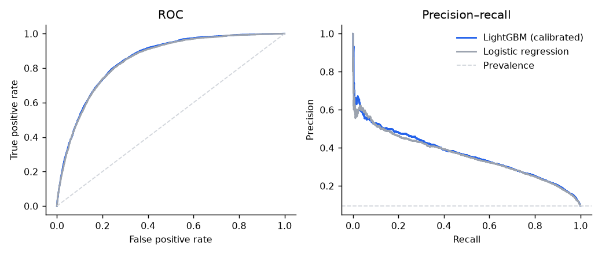
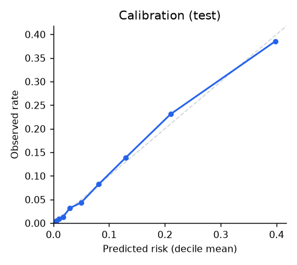
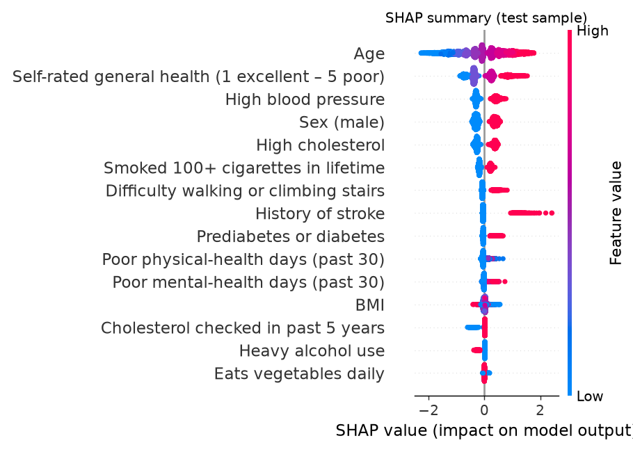
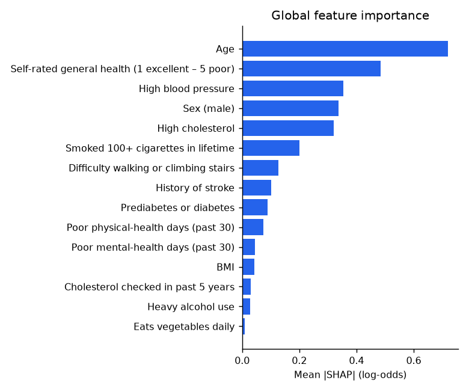

# Model card — Coronary heart disease risk

`cvd_risk` · version `2.0.0+20261126` · trained 2026-11-26T15:19:14+00:00

## Intended use
Highlight patients whose risk-factor profile resembles people with coronary heart disease, to prompt a clinician to review BP, lipids and lifestyle. Decision support only.

**Target:** Respondent reports coronary heart disease or a previous myocardial infarction.

## Data
- Source: CDC Behavioral Risk Factor Surveillance System 2015, 'CDC Diabetes Health Indicators'. UCI ML Repository id 891.
- Rows after cleaning: 253,680 · prevalence 9.4% (test)
- Split: train 177,576 / val 38,052 / test 38,052 — stratified by outcome
- Data file SHA-256: `9f71fda9d4ae5f48…`

## Model
LightGBM gradient-boosted trees, 17 features, hyper-parameters tuned with Optuna (TPE) on validation PR-AUC, early stopping on validation log-loss, Platt-scaled on the validation set.

## Test-set performance

| Metric | Logistic regression | LightGBM (uncalibrated) | **LightGBM (calibrated)** |
|---|---|---|---|
| ROC-AUC | 0.848 | 0.851 | **0.851** (95% CI 0.845–0.857) |
| PR-AUC | 0.360 | 0.367 | **0.367** (95% CI 0.352–0.381) |
| Brier score | 0.0709 | 0.0701 | **0.0701** |
| Log-loss | 0.2393 | 0.2362 | **0.2362** |

PR-AUC should be read against the base rate of 9.4% (a random model scores ≈ the base rate).

### Operational view — flagging the highest-risk patients

| Flag top | Patients flagged | Precision | Recall (share of all events caught) | Lift vs. random |
|---|---|---|---|---|
| 5.0% | 1,903 | 46.5% | 24.7% | 4.93× |
| 10.0% | 3,805 | 38.6% | 40.9% | 4.09× |
| 20.0% | 7,610 | 30.8% | 65.4% | 3.27× |
| 30.0% | 11,416 | 25.2% | 80.2% | 2.67× |

## Calibration
Predicted risk vs. observed event rate by decile on the test set. Risk bands used in the app are cut on the validation distribution: **moderate** ≥ 10.3%, **high** ≥ 27.4% (top 30% / top 10%).

## What drives predictions

## Subgroup performance
Evaluated at the single global **high-risk** threshold (27.4%). Groups with fewer than 200 test rows are omitted. 

| Attribute | Group | n | Prevalence | Mean predicted | ROC-AUC | Flag rate | TPR | FPR |
|---|---|---|---|---|---|---|---|---|
| sex | female | 21,190 | 7.2% | 7.0% | 0.854 | 5.4% | 28.1% | 3.6% |
| sex | male | 16,862 | 12.2% | 12.2% | 0.838 | 15.4% | 49.7% | 10.6% |
| age_band | 45-64 | 16,614 | 7.1% | 6.9% | 0.841 | 5.0% | 29.4% | 3.1% |
| age_band | <45 | 8,184 | 1.3% | 1.4% | 0.827 | 0.3% | 7.3% | 0.2% |
| age_band | 65+ | 13,254 | 17.3% | 17.3% | 0.769 | 21.8% | 47.9% | 16.3% |

## Limitations
- Self-reported survey data (BRFSS 2015, United States): diagnoses are 'ever told by a doctor', not lab-confirmed, and the population differs from Indian/global patients.
- Cross-sectional: the model estimates current prevalence-style risk, not a validated 10-year incidence (it is not a replacement for clinical scores such as ADA risk test, QRISK or WHO CVD charts).
- Age is coarsened to 5-year bands in the source data.
- Not a medical device. Outputs are decision support for qualified clinicians.
