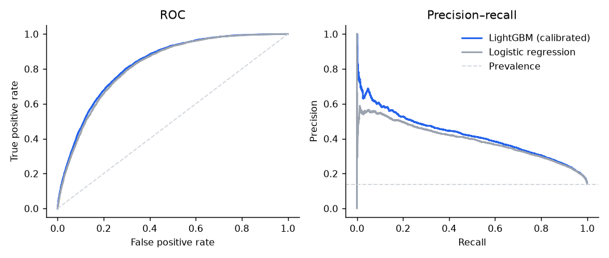
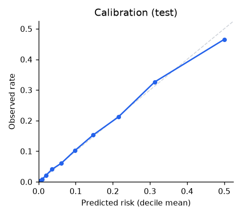
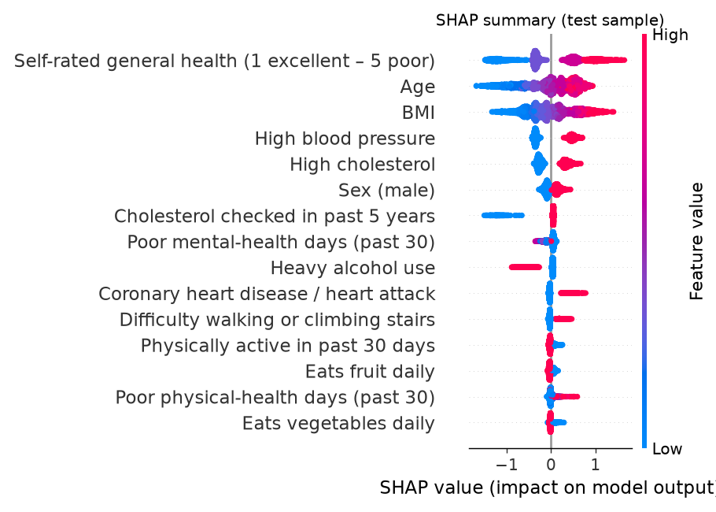
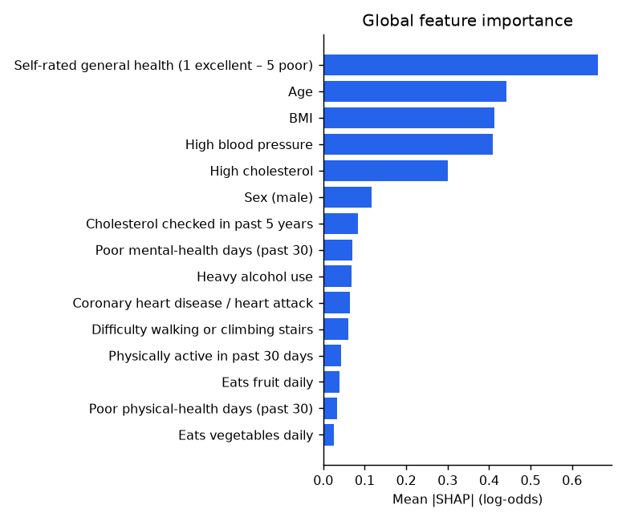

# Model card — Prediabetes / diabetes risk

`diabetes_risk` · version `2.0.0+20261126` · trained 2026-11-26T15:10:17+00:00

## Intended use
Flag adults who may have undiagnosed prediabetes/diabetes so they can be offered an HbA1c or fasting-glucose test. Screening prompt only — never a diagnosis.

**Target:** Respondent reports a doctor ever told them they have prediabetes or diabetes.

## Data
- Source: CDC Behavioral Risk Factor Surveillance System 2015, 'CDC Diabetes Health Indicators'. UCI ML Repository id 891.
- Rows after cleaning: 253,680 · prevalence 13.9% (test)
- Split: train 177,576 / val 38,052 / test 38,052 — stratified by outcome
- Data file SHA-256: `9f71fda9d4ae5f48…`

## Model
LightGBM gradient-boosted trees, 17 features, hyper-parameters tuned with Optuna (TPE) on validation PR-AUC, early stopping on validation log-loss, Platt-scaled on the validation set.

## Test-set performance

| Metric | Logistic regression | LightGBM (uncalibrated) | **LightGBM (calibrated)** |
|---|---|---|---|
| ROC-AUC | 0.818 | 0.826 | **0.826** (95% CI 0.821–0.832) |
| PR-AUC | 0.391 | 0.420 | **0.420** (95% CI 0.408–0.432) |
| Brier score | 0.1003 | 0.0977 | **0.0978** |
| Log-loss | 0.3229 | 0.3148 | **0.3149** |

PR-AUC should be read against the base rate of 13.9% (a random model scores ≈ the base rate).

### Operational view — flagging the highest-risk patients

| Flag top | Patients flagged | Precision | Recall (share of all events caught) | Lift vs. random |
|---|---|---|---|---|
| 5.0% | 1,903 | 52.8% | 18.9% | 3.79× |
| 10.0% | 3,805 | 46.5% | 33.4% | 3.34× |
| 20.0% | 7,610 | 39.6% | 56.8% | 2.84× |
| 30.0% | 11,416 | 33.4% | 72.0% | 2.40× |

## Calibration
Predicted risk vs. observed event rate by decile on the test set. Risk bands used in the app are cut on the validation distribution: **moderate** ≥ 17.6%, **high** ≥ 37.4% (top 30% / top 10%).

## What drives predictions

## Subgroup performance
Evaluated at the single global **high-risk** threshold (37.4%). Groups with fewer than 200 test rows are omitted. 

| Attribute | Group | n | Prevalence | Mean predicted | ROC-AUC | Flag rate | TPR | FPR |
|---|---|---|---|---|---|---|---|---|
| sex | male | 16,735 | 15.4% | 15.3% | 0.811 | 11.1% | 33.6% | 7.1% |
| sex | female | 21,317 | 12.8% | 13.0% | 0.838 | 9.6% | 34.4% | 5.9% |
| age_band | 45-64 | 16,327 | 13.5% | 13.5% | 0.830 | 9.7% | 33.6% | 6.0% |
| age_band | 65+ | 13,493 | 20.4% | 20.8% | 0.755 | 16.4% | 36.5% | 11.3% |
| age_band | <45 | 8,232 | 4.2% | 4.0% | 0.859 | 1.2% | 16.4% | 0.5% |

## Limitations
- Self-reported survey data (BRFSS 2015, United States): diagnoses are 'ever told by a doctor', not lab-confirmed, and the population differs from Indian/global patients.
- Cross-sectional: the model estimates current prevalence-style risk, not a validated 10-year incidence (it is not a replacement for clinical scores such as ADA risk test, QRISK or WHO CVD charts).
- Age is coarsened to 5-year bands in the source data.
- Not a medical device. Outputs are decision support for qualified clinicians.
