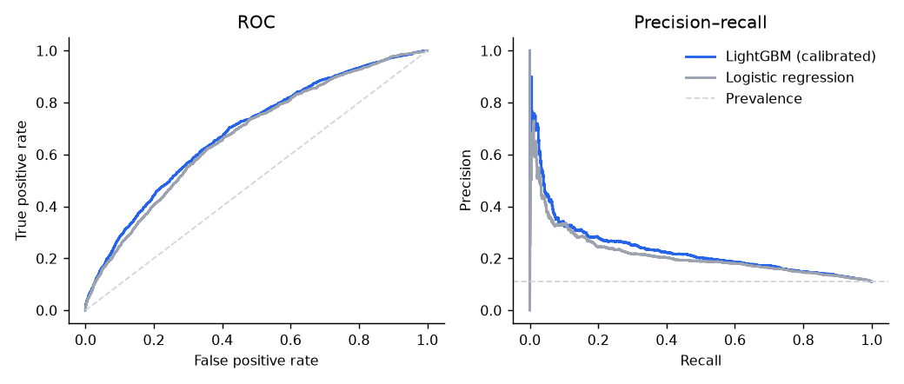
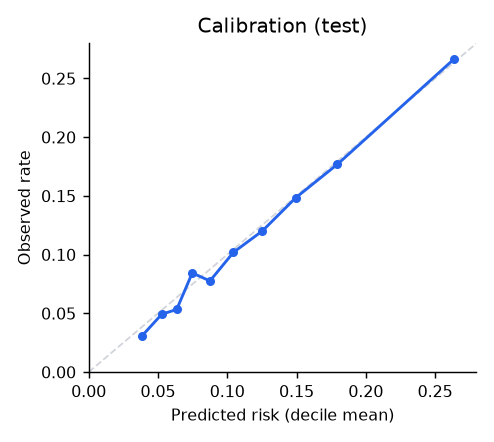
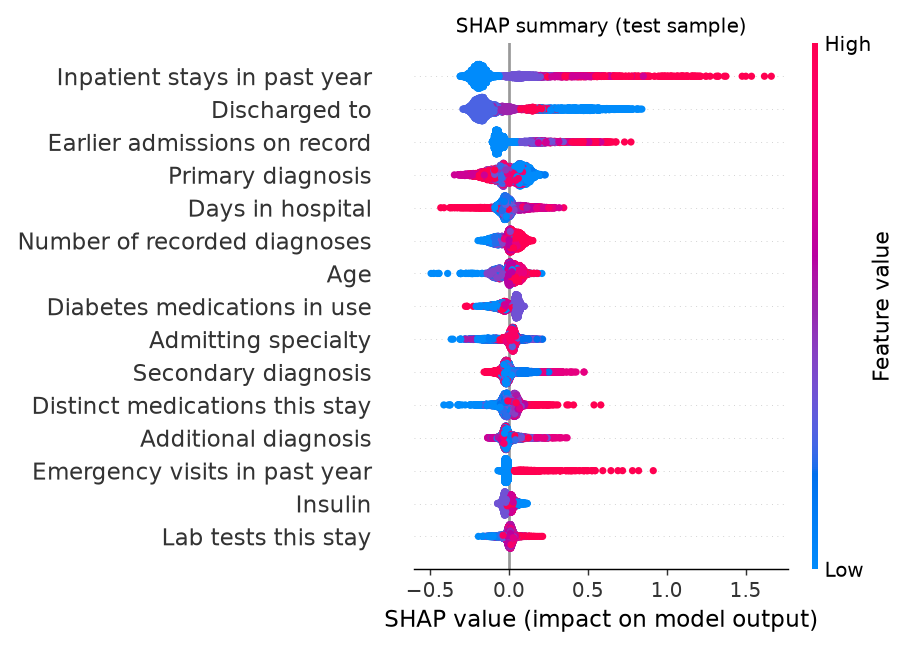
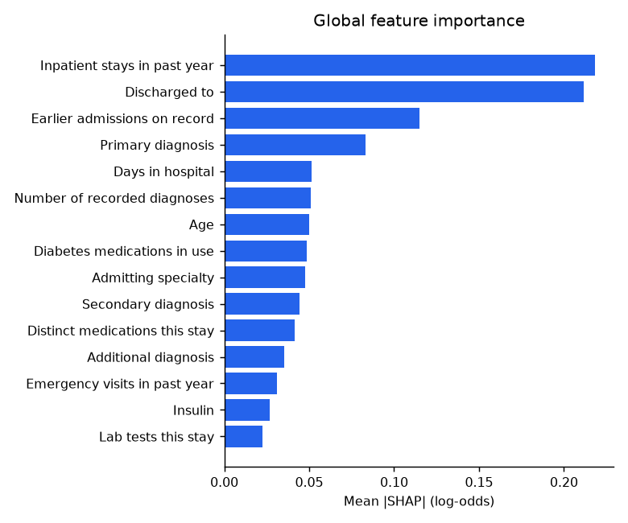

# Model card — 30-day hospital readmission risk

`readmission_30d` · version `2.0.0+20261126` · trained 2026-11-26T13:41:49+00:00

## Intended use
Rank adult inpatients with diabetes at discharge by their likelihood of 30-day readmission, so a care team with limited capacity can prioritise follow-up calls, medication reconciliation and early outpatient appointments. Decision support only — not for denying care.

**Target:** Patient is readmitted to hospital within 30 days of this discharge.

## Data
- Source: Strack et al. (2014), 'Impact of HbA1c Measurement on Hospital Readmission Rates', BioMed Research International. UCI ML Repository id 296.
- Rows after cleaning: 99,340 · prevalence 11.1% (test)
- Split: train 69,702 / val 14,823 / test 14,815 — **grouped by patient** (no patient in more than one split)
- Data file SHA-256: `0689e7ec031237dc…`

## Model
LightGBM gradient-boosted trees, 25 features, hyper-parameters tuned with Optuna (TPE) on validation PR-AUC, early stopping on validation log-loss, Platt-scaled on the validation set.

## Test-set performance

| Metric | Logistic regression | LightGBM (uncalibrated) | **LightGBM (calibrated)** |
|---|---|---|---|
| ROC-AUC | 0.673 | 0.687 | **0.687** (95% CI 0.673–0.701) |
| PR-AUC | 0.213 | 0.232 | **0.232** (95% CI 0.210–0.259) |
| Brier score | 0.0946 | 0.0934 | **0.0934** |
| Log-loss | 0.3303 | 0.3255 | **0.3254** |

PR-AUC should be read against the base rate of 11.1% (a random model scores ≈ the base rate).

### Operational view — flagging the highest-risk patients

| Flag top | Patients flagged | Precision | Recall (share of all events caught) | Lift vs. random |
|---|---|---|---|---|
| 5.0% | 741 | 30.9% | 13.9% | 2.78× |
| 10.0% | 1,482 | 26.7% | 24.0% | 2.40× |
| 20.0% | 2,963 | 22.2% | 40.0% | 2.00× |
| 30.0% | 4,444 | 19.7% | 53.3% | 1.78× |

## Calibration
Predicted risk vs. observed event rate by decile on the test set. Risk bands used in the app are cut on the validation distribution: **moderate** ≥ 13.6%, **high** ≥ 19.8% (top 30% / top 10%).

## What drives predictions

## Subgroup performance
Evaluated at the single global **high-risk** threshold (19.8%). Groups with fewer than 200 test rows are omitted. Race is **not** a model input; it is reported here only to check for disparate performance.

| Attribute | Group | n | Prevalence | Mean predicted | ROC-AUC | Flag rate | TPR | FPR |
|---|---|---|---|---|---|---|---|---|
| race | Caucasian | 11,093 | 11.4% | 11.5% | 0.687 | 10.6% | 25.5% | 8.6% |
| race | Unknown | 342 | 7.9% | 10.1% | 0.651 | 7.3% | 18.5% | 6.3% |
| race | AfricanAmerican | 2,744 | 10.1% | 11.3% | 0.674 | 11.1% | 21.9% | 9.9% |
| race | Other | 233 | 12.4% | 9.8% | 0.752 | 7.7% | 27.6% | 4.9% |
| race | Hispanic | 305 | 10.2% | 10.6% | 0.767 | 10.2% | 38.7% | 6.9% |
| sex | male | 6,686 | 10.9% | 11.3% | 0.678 | 10.7% | 25.6% | 8.9% |
| sex | female | 8,129 | 11.3% | 11.5% | 0.694 | 10.3% | 24.5% | 8.5% |
| age_band | 65+ | 9,835 | 11.4% | 11.9% | 0.655 | 10.5% | 20.9% | 9.2% |
| age_band | 45-64 | 4,026 | 10.5% | 10.2% | 0.725 | 9.2% | 30.0% | 6.8% |
| age_band | <45 | 954 | 10.1% | 11.2% | 0.804 | 15.8% | 51.0% | 11.9% |

## Limitations
- Training data is 1999–2008 US hospital encounters of diabetic patients; practice patterns and coding have changed and the population is not Indian or global.
- Readmissions to a different hospital are not observed in the source data (label noise).
- ICD-9 → ICD-10 mapping for live use is chapter-level only.
- Discrimination on this dataset is modest in published work (ROC-AUC ≈ 0.65–0.70); use as a prioritisation aid, not a diagnostic.
- Not a medical device. Outputs are decision support for qualified clinicians.
